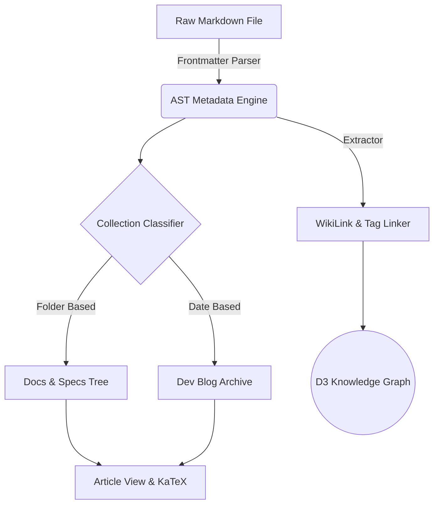

# Welcome to Hakushi

Hakushi is an advanced documentation and digital garden template designed for seamless organization of articles, blog posts, research papers, and architecture decision records.

:::tip
**Flexible File Layouts**
Unlike rigid platforms, Hakushi supports any file/folder layout. A file like `my-note.md` or `docs/architecture/overview.md` stands independently without needing an `index.md` wrapper!
:::

## Key Capabilities

1. **Multi-Collection Architecture**: Organize notes under `Docs`, `Dev Blog`, `Research`, or `Specs`.
2. **Interactive Knowledge Graph**: Visualize relationships between [[getting-started]], [[quantum-computing]], and [[rfc-001-graph-view]].
3. **Rich Markdown Suite**: Supports KaTeX math formulas, code diffs, tabs, Mermaid diagrams, and searchable data tables.

---

## Code Block Features & Diffs

Hakushi code blocks feature line-highlighting, copy buttons, file headers, and code diff support:

```typescript title="src/config/hakushi.config.ts"
// Highlighting code changes with diffs
export const siteConfig = {
  title: 'Hakushi Notes',
-  version: '1.0.0-beta',
+  version: '2.5.0-release',
  theme: {
-    mode: 'dark-only',
+    selectableThemes: ['hakushi', 'obsidian', 'nord', 'amber', 'monokai'],
  },
};
```

:::tab Code Switcher
```typescript title="Node.js Client"
import { HakushiGraph } from '@hakushi/core';

const graph = new HakushiGraph({ mode: 'interactive' });
await graph.render('#graph-root');
```

```python title="Python Client"
from hakushi import KnowledgeGraph

graph = KnowledgeGraph(mode="interactive")
graph.visualize(target_id="#graph-root")
```
:::

---

## Embedded Mathematical Formulae

We render mathematical proofs seamlessly using KaTeX inline $E = mc^2$ and block expressions:

$$
\mathcal{L}(\theta) = - \frac{1}{N} \sum_{i=1}^{N} \left[ y_i \log(\hat{y}_i) + (1 - y_i) \log(1 - \hat{y}_i) \right] + \lambda \|\theta\|_2^2
$$

where $\lambda$ represents the L2 regularization hyperparameter.

---

## System Workflow Diagram

Here is an architectural flow powered by **Mermaid.js**:



---

## Related Notes & Links
- Read our dated post on [[quantum-computing|Quantum Computing Innovations]].
- Check out the system spec in [[rfc-001-graph-view|RFC 001: Knowledge Graph Spec]].
- Learn about themes in [[hakushi-themes|Customizing Schemes & Typography]].
