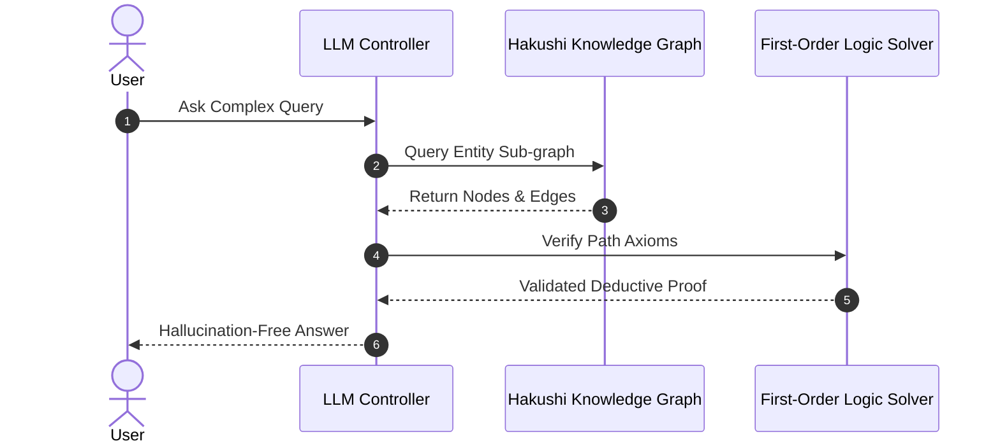

Pure neural models excel at pattern recognition but struggle with multi-hop logical deduction and strict factual constraint verification.

:::danger
**The Hallucination Challenge**
Generative models without graph constraints produce plausible-sounding statements that violate domain-specific logical axioms.
:::

## Hybrid Knowledge Architecture

By anchoring vector embeddings to explicit knowledge graph nodes, we define a hybrid reasoning energy function:

$$
E(h, r, t) = \| \mathbf{e}_h + \mathbf{r}_r - \mathbf{e}_t \|_2^2 + \gamma \sum_{k} \text{AxiomViolation}_k(h, r, t)
$$

Where $\mathbf{e}_h, \mathbf{e}_t \in \mathbb{R}^d$ are entity embeddings and $\mathbf{r}_r$ is the relation embedding vector.

---

## Related Notes
- See blog post [[2026-08-01-quantum-computing|Quantum Advantage in QNNs]].
- See architecture spec [[rfc-001-graph-view|RFC 001 Graph Specification]].
